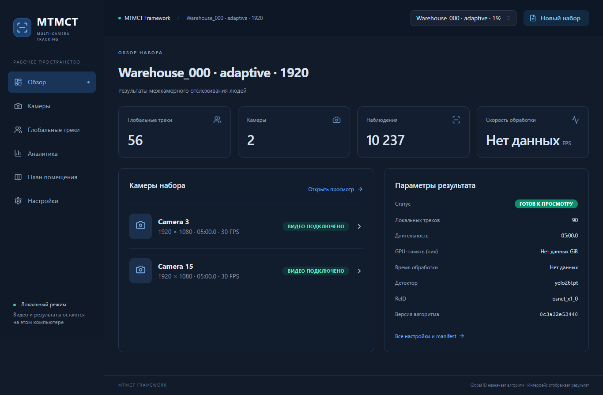
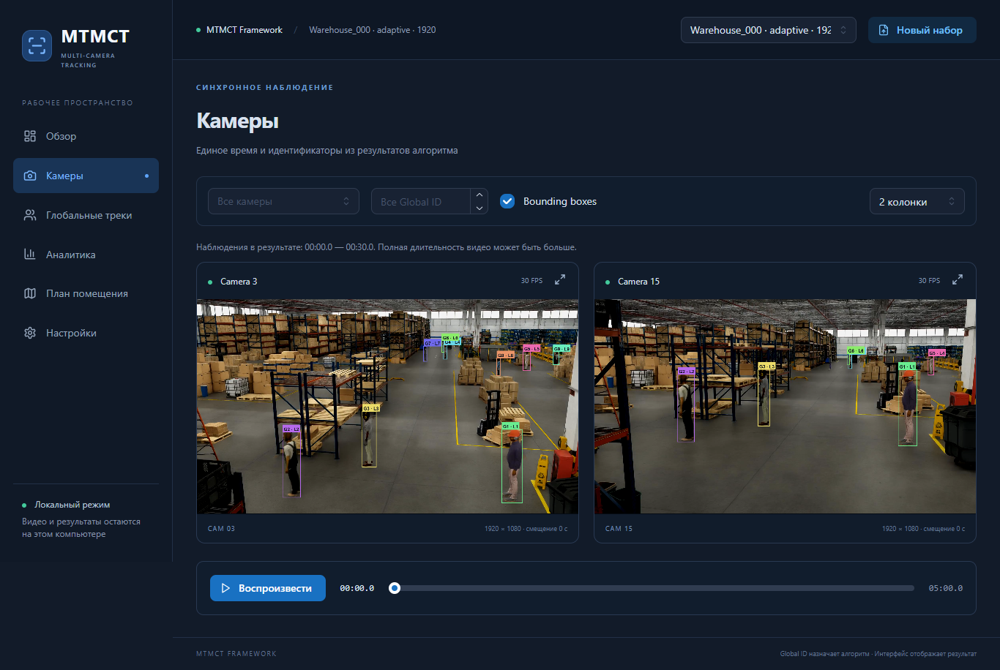
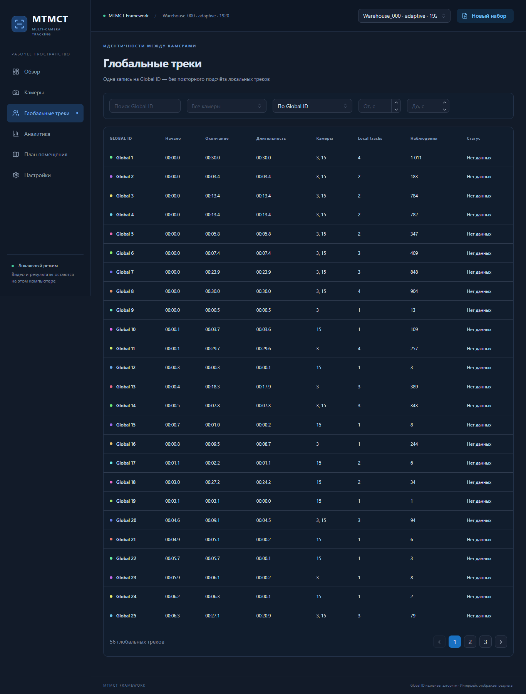
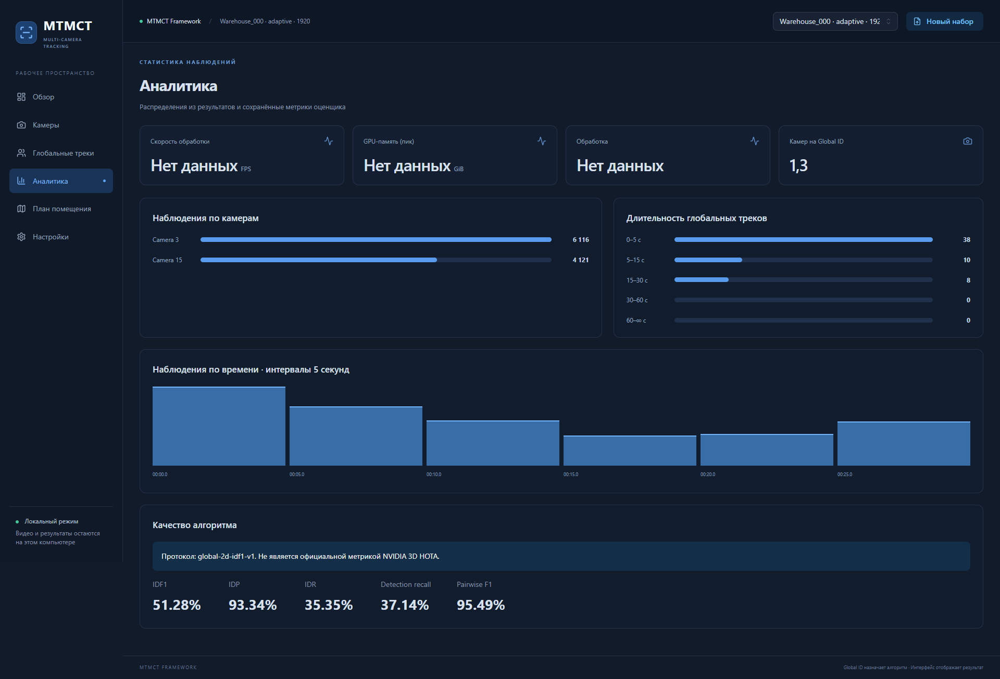

# Локальный интерфейс MTMCT

Ветка `codex/local-web-interface`. Русский интерфейс React / TypeScript / Mantine
и REST API FastAPI работают локально. Детекция, ByteTrack, ReID и ассоциация
используют существующий Python-код. Файлы `mtmct/` для интерфейса не менялись.
Аудит форматов и точек интеграции: [WEB_AUDIT.md](WEB_AUDIT.md).

## Запуск на этом компьютере

На рабочем компьютере `run_web.cmd` использует активное Conda-окружение, затем
`neuro_clean`, затем `.venv`. Зависимости frontend и production-сборка подготовлены.
В корне репозитория запустите **`run_web.cmd`**, затем откройте
**http://127.0.0.1:8000**. Окно сервера оставьте открытым; Ctrl+C останавливает приложение.
После перезагрузки компьютера повторите эту команду. Node.js при таком запуске не нужен.
Если приложение уже работает на порту 8000, достаточно открыть адрес в браузере.

В меню «Новый набор» → «Открыть результат из проекта» выберите каталог из `runs`.
Например, `runs/adaptive_final_development/full` — сохранённый результат эксперимента,
`runs/nvidia_branch_1920` — исходный прогон с performance.json.
Импорт не изменяет исходный каталог и не запускает нейросети.

## Установка на другом компьютере

Проверено на Windows, Python 3.11, Node.js 24, pnpm, PyTorch 2.6.0+cu124,
torchvision 0.21.0+cu124. GPU: GTX 1660 Ti Max-Q, 6 GiB.
Linux-команды приведены ниже, но отдельного прогона на Linux не было.

Из корня репозитория, PowerShell:

```powershell
py -3.11 -m venv .venv
.venv/Scripts/python.exe -m pip install --upgrade pip
# Проверенная CUDA-сборка для совместимого NVIDIA-драйвера:
.venv/Scripts/python.exe -m pip install torch==2.6.0 torchvision==0.21.0 --index-url https://download.pytorch.org/whl/cu124
.venv/Scripts/python.exe -m pip install -e ".[dev]" -r backend/requirements.txt
# Необходимо для обработки с OSNet; просмотр готовых результатов не требует OSNet:
.venv/Scripts/python.exe -m pip install git+https://github.com/KaiyangZhou/deep-person-reid.git
cd frontend
pnpm install --frozen-lockfile
pnpm build
cd ..
.\run_web.cmd
```

Для CPU вместо CUDA-индекса используйте `https://download.pytorch.org/whl/cpu`,
а при запуске обработки выберите `cpu`. CPU-инференс значительно медленнее;
в этой проверке обработка выполнялась на CUDA. На машине должны быть Git, Python,
Node.js и pnpm. Если установлен только npm, можно выполнить `npm install` и
`npm run build`, но точные версии frontend зафиксированы именно в `pnpm-lock.yaml`.

Linux: `python3.11 -m venv .venv`, далее используйте `.venv/bin/python`
вместо `.venv/Scripts/python.exe`; установка frontend такая же, запуск: `sh run_web.sh`.

Для инференса положите **yolo26l.pt** в корень репозитория и OSNet checkpoint в
**weights/**. Используется модель `osnet_ibn_x1_0`, как в офисном эксперименте.
На текущем компьютере оба файла уже есть. Worker проверяет наличие локальных моделей
и не скачивает их во время обработки. GPU/CUDA не нужны для просмотра готового результата.

## Режим разработки

Первый терминал, корень проекта:

```powershell
$env:OPENCV_FFMPEG_THREADS='1'
.venv/Scripts/python.exe -m uvicorn backend.main:app --host 127.0.0.1 --port 8000
```

Второй терминал: `cd frontend`, `pnpm dev`. Откройте http://127.0.0.1:5173.
Vite проксирует `/api` на backend. После изменения frontend для обычного запуска
через порт 8000 повторите `pnpm build`. Для изменения Python перезапустите backend.

## Работа с данными

**Готовые результаты.** Поддерживается собственный формат MTMCT. Загрузите доступные
CSV/JSON в разделе «Новый набор». Можно дополнительно приложить видео с соответствующими
Camera ID. Файлы manifest, performance и association edges необязательны.
Без видео доступны таблицы; без FPS недоступна временная привязка; без mapping остаются
Local ID; отсутствующие сведения показываются как «Нет данных».
`config.yaml` в этом репозитории содержит JSON, произвольный YAML не поддерживается.
Схемы и REST API: [backend/README.md](../backend/README.md).

**Исходные видео.** Выберите режим «Исходные видео → обработка», загрузите несколько
видео, задайте уникальные Camera ID, названия и смещения. До отправки видео можно удалить.
После загрузки выберите ограничение кадров и устройство, нажмите «Запустить обработку».
В интерфейсе по умолчанию видео обрабатывается целиком: ограничение времени — 0. Ограничение
кадров по умолчанию отключено (0); при заданных двух ограничениях действует меньшее.
Разный FPS камер учитывается.
Доступны этапы, время и журнал; фиктивный процент прогресса не показывается.

Worker вызывает тот же код, что `run_hackaton_experiment.py`: YOLO26l, размер 1536,
confidence 0.10, stride 2, ByteTrack и `osnet_ibn_x1_0`. После детекции добавляются
признаки верхней и нижней одежды и запускается graph association с временными смещениями.
Для офисных Camera ID 2 и 4 автоматически используются проверенные зоны камеры 3 и 5:
камера 5 получает дополнительную дальнюю область, а камера 3 игнорирует дальний конец
коридора и людей на телевизоре. Имена `camera_new_1.mkv` … `camera_new_5.mkv`
автоматически получают Camera ID 0…4 и смещения 0, 1, 1, 4, 3 секунды.

Задания выполняются по одному. Каждая камера запускается в отдельном дочернем Python-
процессе, чтобы память моделей освобождалась перед следующей камерой. Артефакты камер
объединяются без изменения ID/эмбеддингов, после чего вызывается штатная ассоциация.
При перезапуске сервера незавершённая задача получает ошибку и требует повторного запуска.

**Просмотр.** Камеры имеют общий таймлайн; смещение означает
`общее время = frame_id / fps + offset`. Собственная длительность каждой камеры
учитывается. Рамки — пиксельные координаты исходного результата, цвета стабильны по
Global ID. Видео может быть длиннее обработанного участка: диапазон наблюдений
подписан над плеерами. Вне этого участка отсутствие рамок ожидаемо.

**Аналитика.** Global tracks — уникальные Global ID, а не сумма локальных треков.
FPS обработки = сумма processed_frames / сумма seconds; это не частота видеозаписи.
GPU-показатель — максимум `peak_cuda_tensor_gib`, не вся память процесса/драйвера.
Метрики качества читаются из metrics.json; оценщик и GT при просмотре не запускаются.
`global-2d-idf1-v1` явно обозначен пользовательским протоколом, не NVIDIA 3D HOTA.

**План помещения.** Для полного офисного набора автоматически подключаются сохранённые
план и приблизительные привязки пяти камер. Для другого набора загрузите PNG/JPG,
выберите камеру и нажмите на схему, чтобы
сохранить её положение. Эти метки не являются калибровкой. Координаты людей и
предполагаемые траектории без геометрической привязки не рисуются.

## Хранение и ограничения

- Реестр, загруженные файлы, SQLite-индексы, логи и результаты: `data/web/<uuid>/`.
  Импорты ссылаются на оригинальные результаты в `runs`; не перемещайте их после импорта.
  Каталог реестра можно переопределить переменной `MTMCT_WEB_STORE`.
- Видео: MP4/MOV/MKV/AVI, до 4 GiB на файл. Backend проверяет фактическое декодирование
  OpenCV. Браузер может не поддержать кодек, который декодирует OpenCV; для просмотра
  используйте MP4 H.264. Автоматического перекодирования нет.
- CSV/JSON: до 200 MiB на загружаемый файл. Наблюдения индексируются потоково в SQLite;
  браузер получает страницы и короткие временные окна, не полный CSV.
  Списки глобальных треков агрегируются на backend; чрезвычайно большие наборы требуют
  дальнейшего SQL-пагинирования самих агрегатов. JSON треклетов читается потоково.
- Поддерживается native MTMCT adapter. NVIDIA-видео и результаты проекта проверены;
  прямого импорта произвольных NVIDIA GT, CITIC, SCOUT или чужих CSV-схем нет.
  Для них нужен отдельный адаптер со специфицированным соответствием полей.
- Файл ассоциаций может содержать кандидатов, а не принятые связи. Интерфейс это поясняет;
  карточка показывает первые 200 относящихся к треку рёбер.
- Приложение рассчитано на один локальный backend-процесс, без авторизации. Запускайте
  на 127.0.0.1; внешний хостинг и многопользовательская эксплуатация не настроены.
- Отмена задачи и удаление наборов через UI не реализованы. Не прерывайте сервер во время
  обработки без необходимости. Данные, веса, видео, сборка и инференс не включаются в Git.

## Ошибки и восстановление

- «Backend недоступен»: запустите `run_web.cmd`, проверьте порт 8000.
- Frontend не собран: выполните `pnpm install --frozen-lockfile`, затем `pnpm build` в frontend.
- Видео не играет: проверьте браузерный кодек. Переименование расширения не меняет кодек.
- CSV/JSON не принимается: проверьте имена, структуру, обязательные столбцы и уникальные ID;
  сообщение указывает файл/строку. Несогласованный mapping и CSV отклоняются.
- Нет рамок: проверьте подключение правильных видео, FPS, Camera ID и диапазон обработки.
- CUDA out of memory / системная память: закройте другие GPU-приложения, проверьте
  свободную RAM и файл подкачки либо выберите CPU. Журнал доступен в карточке задачи.
  Уменьшение числа кадров сокращает время, но не устраняет пик VRAM на одном кадре.
- После сбоя: запустите сервер снова; готовые наборы сохраняются на диске, незавершённую
  обработку можно запустить повторно. Исходные эксперименты `runs` не перезаписываются.

## Проверки и скриншоты

```powershell
.venv/Scripts/python.exe -m pytest -q
cd frontend
pnpm test
pnpm build
# Backend должен работать на 8000; используется установленный Microsoft Edge:
pnpm test:e2e
# Необязательная проверка реального GPU-инференса через UI:
$env:WEB_GPU_TEST='1'
pnpm test:e2e
```

GPU-тест требует локальные модели и короткие клипы `runs/web_pipeline_smoke/Camera_*.mp4`.
На текущем компьютере они подготовлены из настоящих NVIDIA-видео.
`python -m backend.smoke_pipeline` из корня также создаёт эти клипы и проверяет API
от загрузки до завершения инференса. Для другого браузера задайте `WEB_BROWSER=chrome`
или `chromium` с предварительной установкой браузера Playwright; для Vite — `WEB_URL`.

Результаты проверки и её границы: [WEB_VALIDATION.md](WEB_VALIDATION.md).
Скриншоты настоящих данных:





